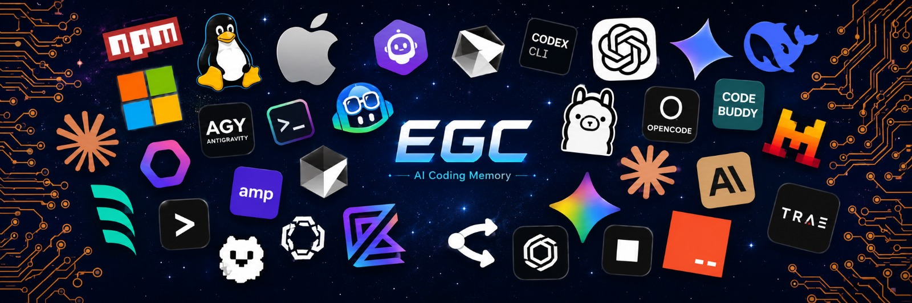
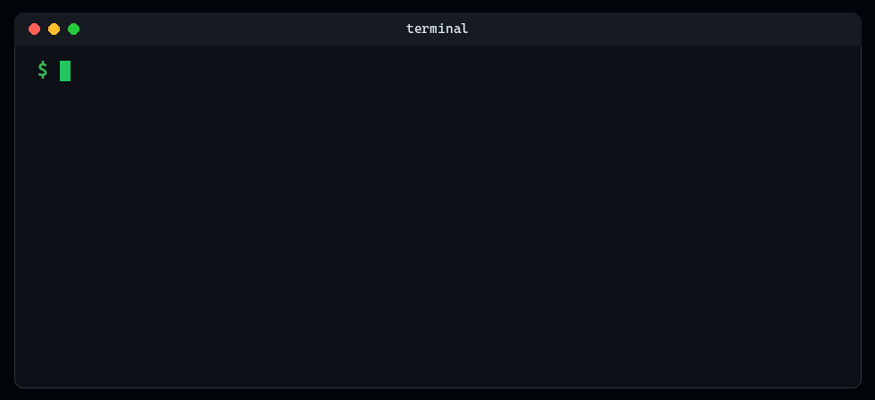
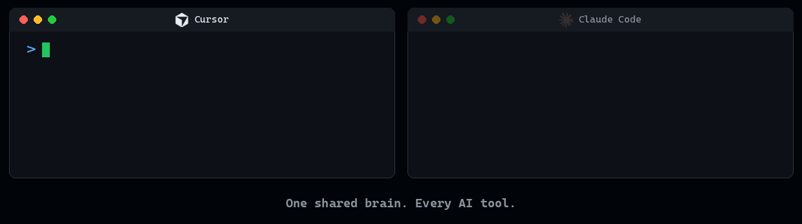
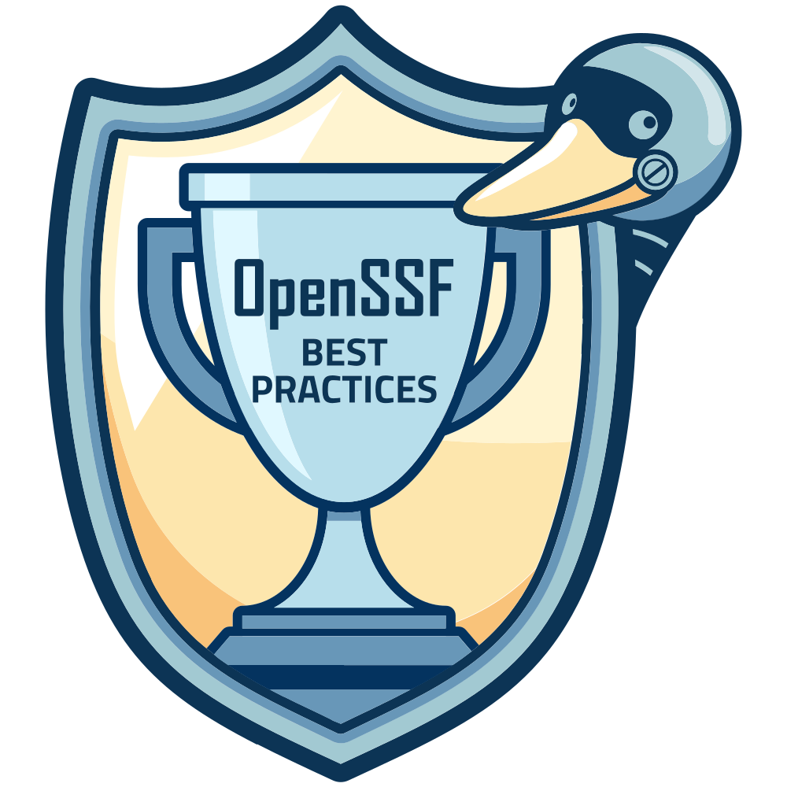

<!-- LANGUAGE-SELECTOR-START -->

🌐 [English](../../README.md) · [العربية](../ar/README.md) · [Deutsch](../de/README.md) · [Español](../es/README.md) · [Français](../fr/README.md) · [हिन्दी](../hi/README.md) · [Italiano](../it/README.md) · [日本語](../ja/README.md) · [한국어](../ko/README.md) · **Português (Brasil)** · [Русский](../ru/README.md) · [Türkçe](../tr/README.md) · [简体中文](../zh-CN/README.md)

<!-- LANGUAGE-SELECTOR-END -->

<div align="center">

</div>

<div align="center">

# EGC - Dê o Mesmo Cérebro a Todos os Seus Agentes de IA

**Um mecanismo local que dá a cada ferramenta de programação de IA na sua máquina a mesma memória, os mesmos guardas e o mesmo contexto, em todas as sessões.**

</div>

---

O EGC é um primeiro tempo de execução local para ferramentas de codificação AI. Instale uma vez e Cursor, Claude Code, Codex, Copilot, Aider e o resto das 29 ferramentas de programação de IA que suporta compartilham uma memória criptografada de seus projetos, um filtro que mantém a saída ruidosa longe do modelo, e um ônibus ao vivo que permite que os seus períodos de sessões abertas se vejam um ao outro. A maioria delas também obtém uma camada de segurança diante de todos os comandos; alguns, como Auggie, não expõe nenhuma superfície de gancho para ela ainda, e [os níveis de integração](../../docs/spec/integration-tiers.md) dizem exatamente quem. Funciona nativamente com Claude, GPT-4o, Gemini, DeepSeek, Mistral, Groq, Cohere e Vertex AI, além do OpenRouter para Qwen3, Llama 4 e mais.

O EGC mantém memória na sua máquina: mora em `~/. gc`, criptografado com AES-256-GCM e mantido por projeto e ramo, e nunca é comprometido com o repositório git do seu projeto. Ele deixa a máquina somente se você ativar o Team Brain, que sincroniza o estado do projeto selado com um controle remoto git privado de sua preferência.

---

## Instalação

```bash
npm install -g @egchq/egc && egc install
```

Esse é o motor todo. `egc install` detecta as ferramentas que você tem, registra os dois servidores MCP locais em cada um deles, escreve o protocolo de memória que cada agente lê e define o Token Crusher. Ela faz uma pergunta, se você também quer a biblioteca facultativa e o padrão é não.

<div align="center">
  
</div>

[Guia completo de instalação](../../docs/installation.md)

---

## Motor: Como funciona o EGC

O FEG é um cérebro com quatro faculdades. Cada um está a partir da primeira instalação, em todas as ferramentas suportadas, sem nenhum comando para aprender.

<div align="center">
  
</div>

### Memória: O Que Um Agente Aprende, Todo Agente Sabe

Decisões, contexto da sessão, memória de trabalho e lições aprendidas são capturadas enquanto você trabalha e estão disponíveis em qualquer outro terminal, IDE ou agente que você abre. Fala-se naturalmente em qualquer língua: "salve esta sessão", "o que é que decidimos sobre autenticação?", "lembra-se desta decisão". O EGC entende a intenção e lojas ou lembra o contexto. Não há nenhum comando para memorizar.

#### Cérebro de Equipe: Sua Memória em Toda Máquina

Para manter o estado do seu projeto passo em suas próprias máquinas, aponte o EGC em um controle remoto git privado. O estado está selado com uma chave de equipe antes de sair da máquina; nenhum servidor EGC está envolvido e o banco de dados de memória não viaja mais (um remoto usado com uma versão anterior pode mantê-lo em seu histórico veja [quais viagens](../../docs/TEAM-BRAIN.md#what-travels-and-what-stays)). Uma chave que não abre nenhum dos arquivos de estado que já estão nos pushes remotos, não faz nada, Portanto, uma chave errada não pode danificar o estado compartilhado, enquanto uma primeira sincronização em pushes remotas vazias como anterior; o [guia do Time Brain](../../docs/TEAM-BRAIN.md#rejected-sync-file-not-a-verified-team-envelope-for-its-path) diz como ler um resultado de sincronização.

```bash
equipe egc init --backend git --remote https://github.com/you/egc-memory. a equipe
egc convida # para essa máquina quando outra das suas se junta; na nova rede, na mesma rede: a equipe do egc se juntou. Os mesmos seis dígitos em ambas as telas, você confirma em ambas as telas, nenhuma chave para copiar a equipe de egc
init --backend git --remote https://github.com/you/egc-memory. ela --key # em uma máquina em outra rede: pede a chave e não a mostra (nada na lista de processos ou no histórico da concha); com --key <team key> na linha, a chave mostra ambos na sincronização
egc da equipe de egc # manualmente; as sessões também sincronizam por si próprias em uma máquina cujo inicio executou com esta versão (uma equipe. son de antes de manter seu próprio interruptor: sincronização automática de egc ao ligá-lo, sincronização automática do time egc desligou)
```

Um controle remoto do GitHub é um lugar para o cofre, não o único. O guia percorre as [cinco configurações](../../docs/TEAM-BRAIN.md#where-the-central-runs-and-how-the-machines-reach-it-five-setups) para onde o cofre e o centro em tempo real podem viver: seu próprio computador (`malha egc serve --install`, o central de volta em cada login), um dispositivo que permanece em um Raspberry Pi ou uma NAS, um servidor seu, um GitHub privado, GitLab ou repositório Gitea como o cofre com o central em casa ou nesse servidor, e uma VPN (Escala Caudal, WireGuard ou aquela que você tem) para uma máquina fora de casa. Um servidor NATS que você já executa substitui o central (`egc mesh connect nats://<host>:4222`). Sem um servidor central ou NATS, o estado ainda sincroniza através do git remoto, e as máquinas só perdem o tempo real; com uma delas, 'estado da malha egc' e 'médico do egco' mostram o centro (ou o servidor NATS), a ponte e as outras máquinas online.

### format@@0 Session Mesh: Your Open Sessions See each other

Duas abas cursoras, um terminal Claude Code e uma sessão antigravity compartilham um ônibus ao vivo. Eles anunciam o que estão trabalhando, reivindiquem os arquivos que editam, trabalhar uns com os outros e pegar eventos: uma sessão estacionada em `session_wait` acorda o momento que uma pousa, as ferramentas com um gancho de virada que pode injetar contexto (Claude Code, Antigraity, Codex, Trae, Amp, Kiro e OpenCode 2) recebem o aviso em sua próxima volta e o Cursor ou Copilot lê o ônibus através das ferramentas da sessão. Sessões paralelas cooperam em vez de colidirem. Com 'serviço de malha egc' em uma das suas máquinas, ou em um servidor NATS que você já executa, o ônibus também cruza para as outras máquinas, sem nenhum servidor nosso: o que se diz é selado ao fim e a caixa se move, retocado ou forjado é descartado, enquanto quem observar o caminho continua a ver que máquina fala com quem, quando e quão muito, então use um endereço `wss://` (`tls://` para um servidor NATS) ou uma VPN em uma rede que você não confia. O [guia do Time Brain](../../docs/TEAM-BRAIN.md#your-machines-in-real-time-the-mesh-first-steps) mostra cinco configurações para o central.

### Guardião: Um Layer de Segurança na Frente de Cada Comando

O Guardião valida os comandos antes que eles executem, portar escritas arriscadas e evita que o contexto transborde, em segundo plano, sem que você invoque nada. A cobertura depende do suporte de gancho próprio de cada ferramenta; [Avaliação de segurança](../../docs/security/SECURITY-ASSESSMENT.md#known-limitations) documenta a exceção. Quando uma tarefa começa, `orchestrate_task` também retorna o código do qual a tarefa se trata, encontrado em um gráfico local do seu projeto; veja [Otimização de token](../../docs/token-optimization.md).

### Cruzador de Token: Ruído Nunca Alcançar o Modelo

Antes que a saída do shell chegue ao modelo, o Token Crusher compõe logs git, teste spam, instalar o ruído e um JSON gigante em até 90 por cento, enquanto mantém todos os erros e avisos. Pergunte "quanto eu economizei?" em qualquer língua e a resposta vem diretamente do seu livro razão local.

---

## Começo Rápido

Não existe passo dois. Abra qualquer uma das suas ferramentas de IA e simplesmente fale: "oi", "vamos continuar", "lembra dessa decisão", em qualquer idioma. Sessões se conectam, cargas de memória e cada aba aberta já sabe o que os outros estão fazendo.

Um painel ao vivo com atividade de agente, tokens e custos começa logo após a instalação. Preferir controle explícito? Todos os comandos estão documentados no [guia de instalação](../../docs/installation.md): mas você provavelmente nunca precisará digitar um.

---

## Biblioteca de Sugestões (opcional)

Separar do motor e fora por padrão, o EGC também envia uma biblioteca escrita de sessões de verdadeira engenharia: você tem acesso a 61 agentes, 232 habilidades e 77 comandos, mais 109 regras. Especialistas que revisam seu código sozinhos, guias de melhor prática para cada idioma e situação, atalhos que executam uma sequência inteira de tarefas e regras de estilo que mantêm seu código consistente. Adicione-a a cada ferramenta detectada com `egc install --prompt-library`, ou a uma ferramenta com `egc install --target <tool> --profile full`. Pule e o motor funcione exatamente da mesma maneira.

---

🌐 [English](../../README.md) · [العربية](../ar/README.md) · [Deutsch](../de/README.md) · [Español](../es/README.md) · [Français](../fr/README.md) · [हिन्दी](../hi/README.md) · [Italiano](../it/README.md) · [日本語](../ja/README.md) · [한국어](../ko/README.md) · **Português (Brasil)** · [Русский](../ru/README.md) · [Türkçe](../tr/README.md) · [简体中文](../zh-CN/README.md)

---

## Apoie o EGC

O EGC é desenvolvido por um único desenvolvedor, mantido de forma aberta e gratuito. O motor é Apache-2. e continua livre: se o EGC oferecer algo pago, será uma camada de equipe em cima dela, nunca a memória na sua máquina.

- **[Website](https://fmarzochi.github.io/EGCSite)**: documentação completa, análise de recursos e demonstração ao vivo
- **[Vision](../../docs/VISION.md)**: para onde o EGC está e o que permanece livre
- **[Entre no Discord](https://discord.gg/FmXbgUmdmM)**: faça perguntas, compartilhe comentários
- **[Patrocine no GitHub](https://github.com/sponsors/Fmarzochi)**: qualquer valor ajuda
- **[Doe pelo PayPal](https://www.paypal.com/donate/?business=fmarzochi%40gmail.com&currency_code=USD)**: sem necessidade de conta no GitHub
- **Marque o repositório com estrela**: ajuda outros desenvolvedores a encontrá-lo
- **[Contribua](../../.github/CONTRIBUTING.md)**: agentes, skills, comandos, correções de bugs, documentação
- **Compartilhe**: se o EGC mudou sua forma de trabalhar, conte para alguém

### Apoiadores

O apoio da comunidade mantém este projeto vivo e independente.

#### Parceiros de ferramentas

Ferramentas de programação com IA que se integram nativamente com o EGC. Os parceiros recebem espaço para logo em todos os READMEs e no EGCSite.

<a href="https://www.pincushion.io/"></a>

#### Patrocinadores anuais · _Seja o primeiro patrocinador anual._

---

#### Patrocinadores

<a href="https://github.com/chizormaangel-commits"></a>

#### Patrocinadores mensais · _seja o primeiro_

---

<div align="center">

[](https://www.bestpractices.dev/projects/13099) [](https://www.bestpractices.dev/projects/13099?level=baseline-1) [](https://www.bestpractices.dev/projects/13099?level=baseline-2) [](https://www.bestpractices.dev/projects/13099?level=baseline-3)

<br>

<a href="https://bestpractices.dev/projects/13099"></a>
&emsp;&emsp;&emsp;&emsp;&emsp;&emsp;&emsp; <a href="https://www.linkedin.com/in/felipemarzochi"></a>

</div>
